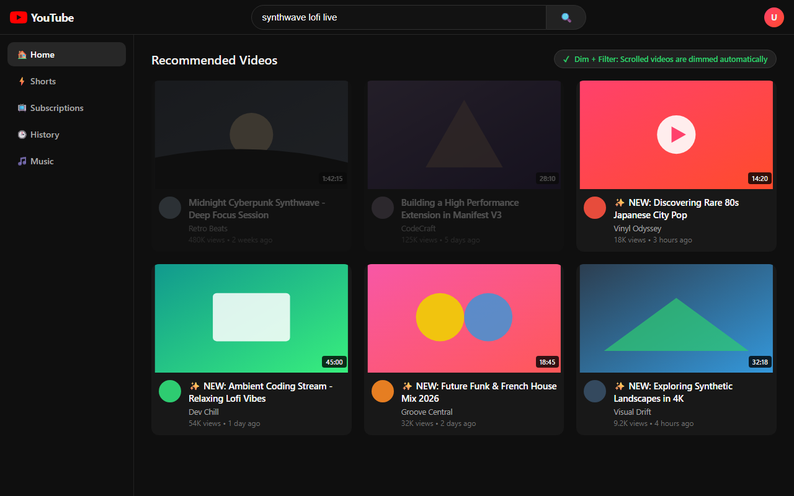
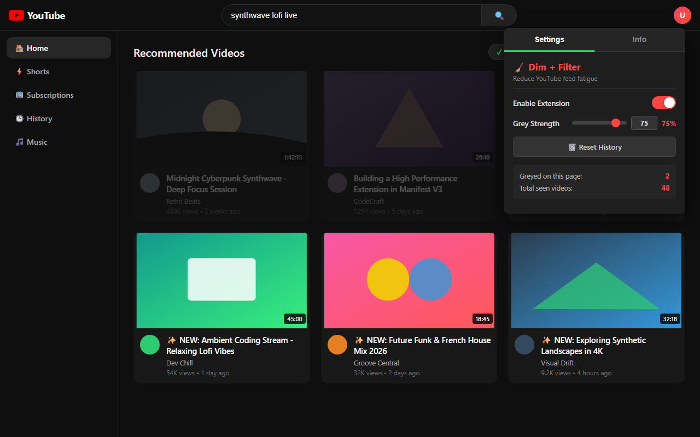
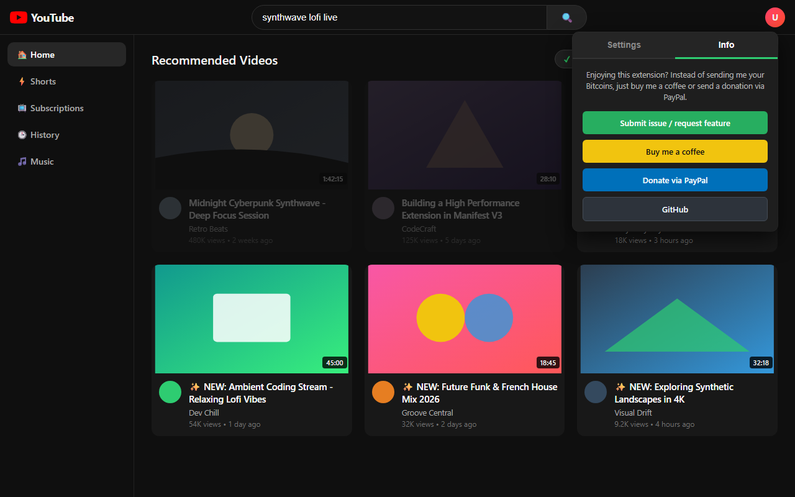

<div align="center">


# Dim + Filter Seen YouTube Videos

*(formerly YouTube Attention Cleaner)*

Videokacheln, an denen du auf YouTube vorbeigescrollt bist, dezent abblenden.  
Frische Empfehlungen stechen sofort heraus, Wiederholungen treten in den Hintergrund.

[](https://chromewebstore.google.com/detail/dim-+-filter-seen-youtube/idefplgokaljonmomjlnffdafbkeghdc)
[](https://microsoftedge.microsoft.com/addons/detail/dim-filter-seen-youtube/elninnhnjkgnijodneiadkkhhgcmpooj)
[](https://addons.mozilla.org/firefox/addon/youtube-attention-cleaner/)

[Deutsch](#deutsch) · [English](#english) · [Screenshots](#screenshots) · [Entwicklung](#entwicklung--tests)

</div>

---

## Offizielle Store-Links

| Browser | Store | Status |
| :--- | :--- | :--- |
| **Google Chrome** | [Chrome Web Store](https://chromewebstore.google.com/detail/dim-+-filter-seen-youtube/idefplgokaljonmomjlnffdafbkeghdc) | v1.1.0 live |
| **Microsoft Edge** | [Microsoft Edge Add-ons](https://microsoftedge.microsoft.com/addons/detail/dim-filter-seen-youtube/elninnhnjkgnijodneiadkkhhgcmpooj) | v1.1.0 live |
| **Mozilla Firefox** | [Firefox Add-ons (AMO)](https://addons.mozilla.org/firefox/addon/youtube-attention-cleaner/) | v1.1.0 live |

---

## Screenshots

| Abgeblendeter Feed | Popup: Einstellungen | Popup: Info & Support |
| :---: | :---: | :---: |
|  |  |  |

---

## Deutsch

Kennst du das? Du machst YouTube auf, scrollst durch den Feed, und fünf Minuten später stehen da schon wieder genau die gleichen Videos, an denen du längst vorbeigescrollt bist. Der Algorithmus wirft sie dir trotzdem noch fünfmal vor die Füße.

Es geht mir hier nicht darum, YouTube umzubauen oder Empfehlungen komplett wegzublocken. Die Idee ist viel simpler: Sobald eine Videokachel wirklich kurz sichtbar war und du an ihr vorbeigescrollt bist, blendet sie sich dezent ab. Was du schon gesehen hast, tritt in den Hintergrund. Neue Videos fallen sofort ins Auge.

### Was steckt drin?

- **Smarte Erkennung:** Eine Kachel muss mindestens zwei Sekunden im Bild und danach zwei Sekunden aus dem Bild sein, bevor sie als gesehen gilt. Schnelles Durchscrollen löst also nichts aus.
- **Echte Klicks bleiben klar:** Videos, die du gezielt anklickst und anschaust, werden natürlich nicht abgeblendet.
- **Feed, Suche, Seitenleiste & Shorts:** Funktioniert auf der Startseite, in den Abos, in der Suche und bei Empfehlungen neben dem Video.
- **Volle Kontrolle im Popup:** Regler für die Abblendstärke von 0 bis 100 %, Hauptschalter und ein Klick zum Zurücksetzen des Verlaufs.
- **Info- & Support-Tab:** Kurzer Weg zu GitHub-Issues und zur Kaffeekasse, falls dir das Tool im Alltag Zeit spart.

### Datenschutz

Keine Tracker, keine Analyse-Dienste, keine externen Server und kein Account. Alle Video-IDs, Zeitstempel und Einstellungen bleiben ausschließlich im lokalen Speicher deines Browsers und laufen nach 65 Tagen automatisch ab.

### Support & Kaffee

Wenn dir die Erweiterung im Alltag Nerven spart, freue ich mich über Feedback oder einen Kaffee statt Bitcoins:

- 🐛 [Issue melden / Feature vorschlagen](https://github.com/codingismynewgaming/youtube-attention-cleaner/issues)
- ☕ [Buy me a coffee](https://buymeacoffee.com/codingiymynewgaming)
- 💳 [Via PayPal spenden](https://www.paypal.com/donate/?hosted_button_id=ZXHJFTUW9NQK8)
- 💻 [GitHub Repository](https://github.com/codingismynewgaming/youtube-attention-cleaner)

---

## English

Ever notice how YouTube keeps serving you the exact same video recommendations you already scrolled past five minutes ago? You skip them, and they keep coming back.

This extension does not try to hack YouTube's recommendation engine or aggressively hide half the page. It does one practical thing: once you've genuinely scrolled past a video tile, it dims it down. Repeats fade quietly into the background, and new videos stand out at a glance.

### How it works

- **Smart visibility checks:** A video card must stay visible for at least two seconds and then scroll out of view for two seconds before it's marked as seen. Fast scrolling won't accidentally dim anything.
- **Videos you actually watch stay clear:** Clicking and watching a video prevents it from getting dimmed.
- **Works across YouTube:** Home feed, Subscriptions, Search results, Shorts, and sidebar recommendations on watch pages.
- **Simple popup controls:** Adjust dim strength from 0 to 100%, toggle off when needed, or wipe history in one click.
- **Info & Support tab:** Quick links to report issues on GitHub or buy a coffee if it saves you daily screen frustration.

### Privacy

No tracking, no analytics, no external servers, and no account required. All IDs, timestamps, and settings stay strictly in your browser's local storage and expire automatically after 65 days.

### Support & Donations

Enjoying this tool? Instead of sending Bitcoins, feel free to leave feedback or buy me a coffee:

- 🐛 [Submit issue / request feature](https://github.com/codingismynewgaming/youtube-attention-cleaner/issues)
- ☕ [Buy me a coffee](https://buymeacoffee.com/codingiymynewgaming)
- 💳 [Donate via PayPal](https://www.paypal.com/donate/?hosted_button_id=ZXHJFTUW9NQK8)
- 💻 [GitHub Repository](https://github.com/codingismynewgaming/youtube-attention-cleaner)

---

## Entwicklung & Tests

Die Browser-Quellen liegen unter `app-files/chrome`, `app-files/edge` und `app-files/firefox`. Lokale Regressionstests laufen mit Node:

```powershell
node --experimental-test-isolation=none --test scripts/*.test.mjs
```

## Lizenz

MIT.
