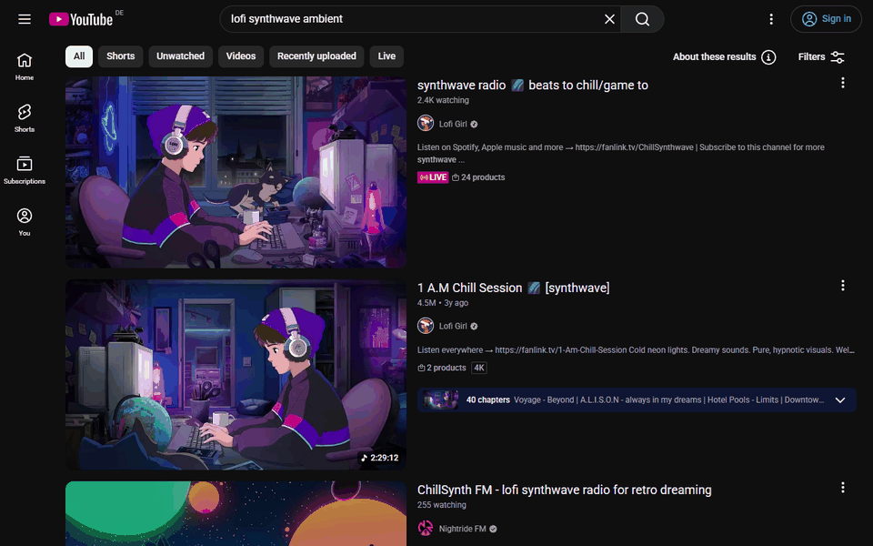

<div align="center">


# Dim + Filter Seen YouTube Videos

*(formerly YouTube Attention Cleaner)*

Dims YouTube tiles you already scrolled past, so new recommendations are easier to see.

[](https://chromewebstore.google.com/detail/dim-+-filter-seen-youtube/idefplgokaljonmomjlnffdafbkeghdc)
[](https://addons.mozilla.org/firefox/addon/youtube-attention-cleaner/)
[](https://addons.mozilla.org/firefox/addon/youtube-attention-cleaner/)
[](https://github.com/codingismynewgaming/youtube-attention-cleaner)
[](#license)

<br />

[](https://chromewebstore.google.com/detail/dim-+-filter-seen-youtube/idefplgokaljonmomjlnffdafbkeghdc)
[](https://microsoftedge.microsoft.com/addons/detail/dim-filter-seen-youtube/elninnhnjkgnijodneiadkkhhgcmpooj)
[](https://addons.mozilla.org/firefox/addon/youtube-attention-cleaner/)

</div>

YouTube puts the same videos back in front of you, even after you already scrolled past them and decided not to click. This extension dims those tiles. It does not hide the homepage, strip the sidebar, or try to rewrite the recommender. The page stays intact. Repeats just take up less visual space.

"Seen" here means you spent two seconds looking at a tile and then scrolled on. It does not mean you watched the video.

## Demo

*GIF placeholder:* add a short loop at `docs/screenshots/demo-before-after.gif`. Record the Home feed, linger on a row, scroll away, come back, and show the same tiles dimmed. Keep it to a few seconds. No captions baked into the frame if you can help it; the alt text can do the explaining.

<!-- Once the file exists, uncomment:
<p align="center">
  
</p>
-->

## Screenshots

| Dimmed feed | Popup: strength | Popup: info |
| :---: | :---: | :---: |
|  |  |  |

Two more shots are planned and not in the repo yet: a watch page with a dimmed sidebar, and a Short that later appears dimmed in the Home feed.

## How it works

The content script watches video tiles with `IntersectionObserver` and `MutationObserver`. It does not scan the page on an interval.

On Home, Subscriptions, Search, and the watch sidebar, a tile is marked seen only if it stays in the viewport for at least two seconds and then stays out of the viewport for two seconds. Fast scrolling does not mark anything.

On a Shorts page, a Short is marked after two seconds in view. That is a shorter rule, because Shorts do not leave the viewport in the same way a feed card does.

If you click or open a video, it is stored as watch intent and stays clear. The main player is never dimmed.

Hidden or background tabs pause tracking, so a tile sitting in an unread tab is not silently marked.

The dim itself is visual only: grayscale plus an overlay, with strength from 0 to 100%. Context menus still work. There is no mode that removes tiles from the layout. "Filter" in the name means this visual filter, not a hide-from-the-feed switch.

## Features

- Dims tiles you scrolled past, including ones you never opened
- Leaves videos you clicked clear
- Works on Home, Subscriptions, Search, the watch sidebar, and Shorts
- Slider for dim strength, a master switch, and a one-click history reset in the popup
- Local storage only; seen and watch-intent entries expire after 65 days; settings stay until you change them

## Where it works

Chrome, Firefox, and Microsoft Edge, on `https://www.youtube.com/*`. Current store version is 1.1.0 in all three listings.

| Browser | Store |
| :--- | :--- |
| Chrome | [Chrome Web Store](https://chromewebstore.google.com/detail/dim-+-filter-seen-youtube/idefplgokaljonmomjlnffdafbkeghdc) |
| Microsoft Edge | [Edge Add-ons](https://microsoftedge.microsoft.com/addons/detail/dim-filter-seen-youtube/elninnhnjkgnijodneiadkkhhgcmpooj) |
| Firefox | [Firefox Add-ons](https://addons.mozilla.org/firefox/addon/youtube-attention-cleaner/) |

## Privacy

No account, no telemetry, no developer server. The extension stores YouTube video IDs, a couple of timestamps, and your settings in the browser's local extension storage. Seen and watch-intent entries expire after 65 days. Settings do not.

The details, including permissions and how to delete the data, are in [PRIVACY.md](PRIVACY.md).

## Permissions

| Permission | Why |
| :--- | :--- |
| `storage` | Save seen IDs, watch-intent IDs, and settings locally. |
| `tabs` | Read the active tab URL and update the popup badge or count for the YouTube tab. |
| `webNavigation` | Notice in-page YouTube navigation and refresh tracking after a history change. |
| `https://www.youtube.com/*` | Run the content script on YouTube and apply the dimming styles. |

## FAQ

**Is this Unhook?**  
No. Unhook hides pieces of the YouTube UI, such as the homepage, Shorts, comments, or the sidebar. This extension leaves the page in place and only dims tiles you already scrolled past.

**Is this the same as a "hide watched" tool?**  
Usually not. Those tools typically follow YouTube's watched or progress state. This one marks a tile when you have scrolled past it, even if you never opened the video. Videos you did open stay clear.

**I used to search for YouTube Attention Cleaner.**  
That was the previous name of this extension. The listings now use Dim + Filter Seen YouTube Videos.

**Does "filter" mean tiles disappear from the feed?**  
No. They stay in the layout and are only dimmed. If you want them gone from the page, this is not that tool.

**Can I undo a dim or start over?**  
Yes. Use Reset in the popup to clear seen and watch-intent history. Your dim strength stays.

## Development

The repo has three Manifest V3 packages, one per store, under `app-files/chrome`, `app-files/edge`, and `app-files/firefox`.

From the repo root:

```bash
node --experimental-test-isolation=none --test scripts/*.test.mjs
python scripts/firefox-smoke.py
python scripts/chromium-smoke.py
npx web-ext lint --source-dir app-files/firefox
node scripts/publish-stores.mjs --build-only
```

`publish-stores.mjs --build-only` builds the store zips. It does not upload them.

## Contributing

Bug reports and ideas are welcome in [Issues](https://github.com/codingismynewgaming/youtube-attention-cleaner/issues). For a larger change, open an issue first so the direction is clear.

If you send a pull request, keep it focused and run the tests above. Please do not add analytics, remote code, or extra host permissions without a very good reason. This project is deliberately small.

## Support

If the extension saves you some frustration, I am glad. Feedback helps more than a silent install. A coffee is welcome too. No need to send Bitcoins.

- [Open an issue](https://github.com/codingismynewgaming/youtube-attention-cleaner/issues)
- [Buy me a coffee](https://buymeacoffee.com/codingiymynewgaming)
- [Donate via PayPal](https://www.paypal.com/donate/?hosted_button_id=ZXHJFTUW9NQK8)

## License

MIT. See [LICENSE](LICENSE).

<details>
<summary>Deutsch</summary>

Videokacheln, an denen du auf YouTube schon vorbeigescrollt bist, werden abgeblendet. Die Seite selbst bleibt. "Gesehen" heißt hier: die Kachel war zwei Sekunden im Bild und danach zwei Sekunden wieder draußen. Auf einer Shorts Seite reicht es, wenn ein Short zwei Sekunden zu sehen war. Das ist nicht der YouTube Verlauf.

Geklickte Videos bleiben klar. Der Player wird nicht abgeblendet. Die Stärke stellst du im Popup ein, von 0 bis 100 Prozent. Einen Schalter zum Ausblenden aus dem Feed gibt es nicht.

Installieren: [Chrome](https://chromewebstore.google.com/detail/dim-+-filter-seen-youtube/idefplgokaljonmomjlnffdafbkeghdc), [Edge](https://microsoftedge.microsoft.com/addons/detail/dim-filter-seen-youtube/elninnhnjkgnijodneiadkkhhgcmpooj), [Firefox](https://addons.mozilla.org/firefox/addon/youtube-attention-cleaner/).

Alles bleibt im lokalen Speicher des Browsers. Gesehene Einträge und die Markierung für angeklickte Videos laufen nach 65 Tagen ab. Die Einstellungen bleiben, bis du sie änderst. Details stehen in der englischen [PRIVACY.md](PRIVACY.md).

Fragen und Fehler: [Issues](https://github.com/codingismynewgaming/youtube-attention-cleaner/issues).

</details>
